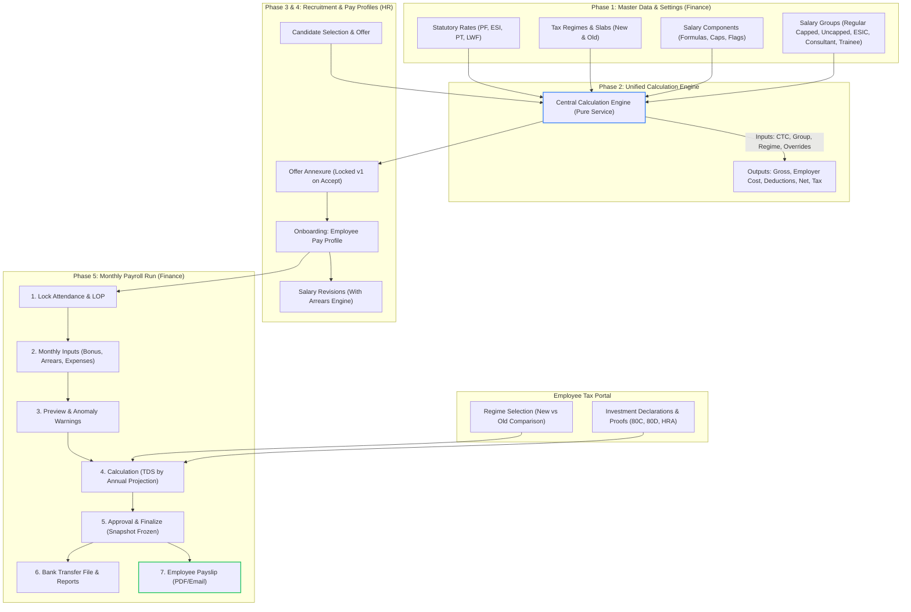

# MIRA ERP — Payroll Engine End-to-End Execution Tracker

> **Project:** CES Tech · MIRA ERP (`nex-erp`)  
> **Source Documents:** `MIRA-Payroll-Plan.pdf`, `MNC_Payroll_PF_Min_15000.xlsx`, and Management MOM  
> **Created:** 23 October 2026  
> **Status:** Active Execution  

---

## 1. End-to-End System Architecture & Flow

> [!IMPORTANT]
> **Key Payslip Presentation Rule:**  
> On the **Employee Payslip (W12 / R7)**, **Employer Contributions (Employer PF & Employer ESIC) are strictly HIDDEN**, preserving the legacy salary slip format. Employer contributions appear only on the **Offer Annexure**, **Finance Salary Calculator**, and **Company Cost / Salary Register Reports**.

---

## 2. Phase-by-Phase Task Tracker

### Phase 1: Master Data & Database Architecture
*Goal: Move all hardcoded statutory percentages, slabs, components, and formulas out of TypeScript code and into fully editable Prisma database models.*

- [x] **Task 1.1: Prisma Schema Design for Payroll Masters** — *done 23 Oct 2026 (Applied to Database)*
  - Added 8 models (append-only, no existing model touched): `PayrollStatutoryRate`, `PayrollComponent`, `PayrollSalaryGroup` (versioned), `PayrollSalaryGroupLine`, `PayrollTaxRegime`, `PayrollTaxSlab`, `PayrollTaxSection`, `PayrollAuditLog`.
  - Component flags: `partOfCtc`, `partOfGross`, `taxable`, `reduceForLop`, `showOnPayslip` (false for employer share), `showOnAnnexure`, `displayOrder`, `isSystem`, `isActive`.
  - Group line `calcType`: `FIXED` | `FORMULA` | `STATUTORY` | `BALANCING` | `INPUT`, plus optional `condition`, `minAmount`/`maxAmount`, `overrideAllowed`.
  - Statutory rates and tax regimes are effective-dated / per financial year — changes add rows, never edit history.
  - Built **alongside** legacy `SalaryComponent`/`SalaryStructure`; the current payroll run does not read the new tables yet.
  - *Files:* `backend/prisma/schema.prisma`, `backend/prisma/manual-sql/2026-10-23-payroll-masters.sql` (applied and active on VPS database).
- [x] **Task 1.2: Seed Initial Master Data from Finance Excel** — *done 23 Oct 2026 (Applied to Database)*
  - Follows Finance's sheet **as written** (decision 23 Oct); disagreements are tagged `FINANCE Qn` in the data file.
  - 7 statutory rates: PF 12%/12% (₹15,000 ceiling), ESIC 0.75%/3.25% (₹21,000 limit), UP PT ₹0, Basic floor ₹13,780, GST 18%.
  - 12 components; employer PF/ESIC have `showOnPayslip = false`.
  - 5 salary groups, one per sheet tab: `REGULAR` (Salary Structure), `REGULAR_PF_CAPPED` (Minimum pf), `REGULAR_VARIABLE` (Variable), `CONSULTANT_TECH` (Contractual, 2% TDS, GST), `TRAINEE`. *(No separate low-wage group: the ₹13,780 floor and ESIC condition are built into `REGULAR`. `Sheet1` skipped — scratch copy with HRA 0.)*
  - New & Old tax regimes for FY 2026-27 (Finance Act 2025 slabs — CA to confirm).
  - Seeded cleanly for Company 1 (CES Tech) and Company 2 (Ces Tech); all 26 entries logged in `PayrollAuditLog`.
  - *Files:* `backend/src/payroll/masters/payroll-seed-data.ts`, `backend/prisma/seed-payroll-masters.ts`
  - Run: `npx ts-node prisma/seed-payroll-masters.ts --company <id> [--apply]`
  - *Files:* `backend/src/payroll/masters/payroll-seed-data.ts` (+ `.spec.ts`, 33 tests), `backend/prisma/seed-payroll-masters.ts`
- [x] **Task 1.3: Backend CRUD APIs for Masters** — *done 23 Oct 2026*
  - Endpoints to create/update components, groups, statutory rates, and tax regimes.
  - Safe formula validation on save (rejects unknown variables and syntax errors, runs test calculation).
  - Employer contributions enforce `showOnPayslip = false` by default.
  - Full audit trail logging for every modification.
  - *Files:* `backend/src/payroll/masters/payroll-masters.controller.ts`, `backend/src/payroll/masters/payroll-masters.service.ts`
- [x] **Task 1.4: Frontend Master Configuration UI** — *done 23 Oct 2026 (Modernized & Polished)*
  - Modern enterprise UI with MIRA Design System tokens, breadcrumbs, live engine status pill, and Lucide SVG icons across all tabs.
  - Tab 1 (Salary Components): 4 KPI cards (Total, Earnings, Deductions, Employer Share), category filters, search bar with clear button, click-to-copy code chips, and explicit `👁 Visible on Slip` vs `🚫 Hidden (CTC only)` status badges.
  - Tab 2 (Salary Groups): Split-layout view with searchable group directory on left (version tag `v1`, payee badges), hero header with formula sequence table on right, and highlighted balancing figure (`OTHER_ALLOWANCE`).
  - Tab 3 (Tax Regimes): Segmented control for New Regime (Sec 115BAC) vs. Old Regime, 4 KPI cards (Std Deduction ₹75k, Sec 87A rebate limit ₹12L, max rebate ₹60k, Cess 4%), visual progressive slab bar, and Chapter VI-A allowed deductions list.
  - Tab 4 (Statutory Rates): 4 compliance highlight cards (EPFO 12%/12%, ESIC 0.75%/3.25%, Basic Floor ₹13,780, Gratuity 4.81%), search filter, state badges, and inline Edit modal.
  - Tab 5 (⚡ Salary Calculator & Simulator): Fintech-grade simulator with Monthly/Annual toggle, 8 quick CTC presets (`₹3.6L` to `₹36L`), real-time breakdown of Gross vs. Employer Cost vs. Net Take-Home Pay, Finance payslip policy alert banner, and annual tax/TDS projection.
  - Tab 6 (Audit Trail): Filterable timeline of all master modifications.
  - Clean modals with backdrop blur for Add/Edit Components, Salary Groups with dynamic formula rows, Statutory Rates, and Tax Regimes & Slabs.
  - *Files:* `frontend/src/app/settings/payroll-settings/` (`payroll-settings.html`, `payroll-settings.css`, `payroll-settings.ts`). Verified via clean `npx ng build` development build.

---

### Phase 2: Central Calculation Engine & Salary Calculator
*Goal: Replace conflicting split algorithms (`salary-template.ts` and `applications.service.ts`) with a single, deterministic calculation engine that accurately mirrors Finance's Excel spreadsheet.*

- [x] **Task 2.1: Implement Pure Calculation Service** — *done 23 Oct 2026*
  - Inputs: `CTC`, `SalaryGroup`, `EffectiveDate`, `TaxRegime`, optional component overrides.
  - Formulas evaluated safely with custom recursive-descent parser (arithmetic, MIN/MAX, comparisons, conditions, functions).
  - Gross derivation: `CTC - (Employer PF + Employer ESIC)`.
  - Balancing line: `Other Allowance = Gross - Σ allowances`.
  - Net Pay: `Gross - (Employee PF + Employee ESIC + TDS + Professional Tax)`.
  - Dual Tax Engine: New Regime (87A rebate up to ₹12L, marginal relief) and Old Regime (80C, 80D, HRA).
  - *Files:* `backend/src/payroll/engine/payroll-calculator.ts`, `backend/src/payroll/engine/formula-evaluator.ts`
- [x] **Task 2.2: Automated Unit Test Suite Against Finance Excel** — *done 23 Oct 2026*
  - 55 automated tests passing with 100% precision:
  - Test Case 1: High CTC (₹1,00,000/mo) with Capped PF (₹1,800) $\rightarrow$ Net ₹96,400.
  - Test Case 2: Mid CTC (₹60,000/mo) with Uncapped PF (₹3,600) $\rightarrow$ Net ₹52,800.
  - Test Case 3: Low CTC (₹25,000/mo) with ₹13,780 floor & ESIC $\rightarrow$ Net ₹21,141.60.
  - Test Case 4: Low CTC (₹22,500/mo) $\rightarrow$ Net ₹18,641.60 — *Other Allowance comes out −₹1,743.45 per sheet; see Q7.*
  - Test Case 5: Consultant (₹18,000/mo) with 2% TDS $\rightarrow$ Net ₹17,640.
  - Test Case 6: Trainee (₹15,000/mo) $\rightarrow$ Net ₹15,000.
  - Test Case 7: Verified `showOnPayslip: false` for all employer contributions!
  - *Files:* `backend/src/payroll/engine/payroll-calculator.spec.ts`, `backend/src/payroll/engine/formula-evaluator.spec.ts`
- [x] **Task 2.3: Interactive Salary Calculator Screen (W7)** — *done 23 Oct 2026*
  - Built-in visual CTC Simulator tab inside `/settings/payroll`:
  - Instant monthly vs annual toggle, group selector, and live calculation.
  - Breakdown table with balancing figure and payslip visibility badges.
  - Highlights employer cost policy and tax projections with Section 87A rebate.
  - *Files:* `frontend/src/app/settings/payroll-settings/`

---

### Phase 3: Employee Pay Profile & Salary Revisions
*Goal: Assign each employee a version-controlled pay profile that accurately records their salary group, CTC, regime choice, and historical revisions.*

- [ ] **Task 3.1: Employee Pay Profile Data Model & API**
  - Schema: `EmployeePayProfile` linking employee to `SalaryGroup`, current CTC, regime choice, bank/IFSC, PAN, UAN, and custom overrides.
  - *Files:* `backend/prisma/schema.prisma`, `backend/src/payroll/services/pay-profile.service.ts`
- [ ] **Task 3.2: Salary Revision & Arrears Engine**
  - Support effective dating on salary revisions.
  - Back-dated revisions automatically calculate differential arrears for elapsed months and enqueue them for the next monthly run.
  - SuperAdmin/Finance approval workflow for revision requests.
  - *Files:* `backend/src/payroll/services/salary-revision.service.ts`
- [ ] **Task 3.3: Employee Pay Profile UI (W9)**
  - View employee compensation history, active grade, payment mode, and revision log.
  - *Files:* `frontend/src/app/payroll/pay-profiles/`

---

### Phase 4: Recruitment Offer Letter to Onboarding (MOM P0)
*Goal: Eliminate discrepancies between offer annexures and monthly payslips by using the Phase 2 engine directly in Recruitment.*

- [ ] **Task 4.1: Integrate Calculation Engine with Offer Letter Flow (W8)**
  - When recruiter inputs Annual CTC and selects Salary Group, the engine computes the exact monthly and annual annexure.
  - Recruiter can specify allowed component overrides (with mandatory justification).
  - *Files:* `backend/src/recruitment/applications.service.ts`, `backend/src/recruitment/offer-letters.service.ts`
- [ ] **Task 4.2: Offer Annexure Locking & Auto-Onboarding**
  - Upon candidate acceptance, the compensation structure is snapshot-frozen as `Annexure v1`.
  - When the candidate is marked as "HIRED" / Onboarded, their `EmployeePayProfile` is automatically created from `Annexure v1`.
  - *Files:* `backend/src/recruitment/applications.service.ts`, `backend/src/onboarding/onboarding.service.ts`

---

### Phase 5: Monthly Payroll Run Lifecycle & Payslips
*Goal: Build a guided, 6-step monthly payroll process with built-in validation, projected tax withholding, frozen historical records, and clean payslips.*

- [ ] **Task 5.1: Step 1 & 2 — Attendance Lock & Monthly Inputs**
  - Attendance sync: pull present, absent, half-days; derive Loss of Pay (LOP) only on components flagged `reduceForLop`.
  - Input ingestion: bonuses, one-off deductions, approved expense reimbursements, arrears from revisions, leave encashment.
  - *Files:* `backend/src/payroll/services/payroll-run.service.ts`
- [ ] **Task 5.2: Step 3 & 4 — Preview Warnings & TDS Projection Engine**
  - Automated anomaly warnings: missing bank details/PAN, pay variance > 20% compared to prior month, unapproved claims.
  - Progressive TDS projection:
    $$\text{Monthly TDS} = \frac{\text{Projected Annual Tax} - \text{TDS Deducted YTD}}{\text{Months Remaining}}$$
  - *Files:* `backend/src/payroll/services/tds-projection.service.ts`
- [ ] **Task 5.3: Step 5 & 6 — Approval, Finalization & Bank Payout File**
  - Two-step approval (Finance Head $\rightarrow$ SuperAdmin).
  - Finalizing creates an immutable frozen snapshot in `Payslip` and `PayslipItem` (rule version + calculated amounts).
  - Export standard Bank Transfer File (NEFT/RTGS CSV format: Account, IFSC, Beneficiary, Net Amount).
  - *Files:* `backend/src/payroll/services/bank-export.service.ts`
- [ ] **Task 5.4: Step 7 — Employee Payslip PDF Generation (W12)**
  - **Compliance Check:** Ensure Employer PF and Employer ESIC do **NOT** appear on the payslip.
  - Display: Employee Info, Paid Days, Earnings breakdown, Employee Deductions breakdown, Net Take Home Pay, YTD TDS.
  - Batch PDF download and automated email dispatch.
  - *Files:* `backend/src/payroll/pdf.service.ts`, `backend/src/payroll/email.service.ts`
- [ ] **Task 5.5: Statutory Compliance Reports**
  - PF ECR (Electronic Challan cum Return) text file export.
  - ESI monthly return report.
  - State PT statement.
  - TDS Form 24Q summary.
  - *Files:* `backend/src/payroll/services/compliance-reports.service.ts`

---

### Phase 6: Consultants, Trainees & Legal Compliance Controls
*Goal: Provide first-class workflows for non-traditional payroll categories and protect against statutory liability.*

- [ ] **Task 6.1: Consultant Monthly Settlement & Payout Statements**
  - Monthly fee processing with automated 2% (Technical - 194J) or 10% (Non-Technical) TDS deduction.
  - GST invoice matching & addition where GSTIN is on file.
  - Payout statement generation (replaces standard salary slip).
- [ ] **Task 6.2: Trainee Stipend Processing**
  - Fixed monthly stipend processing; deductions applied only for approved unpaid leave.
- [ ] **Task 6.3: Legal Guardrail on PF Opt-Out**
  - Strict system warning: If an employee has ever had PF deducted on a finalized payslip, reassigning them to a Consultant or No-PF group is blocked without SuperAdmin + Legal approval.

---

### Phase 7: Costing & Advanced Capabilities
*Goal: Real-time project costing feeds and year-end tax compliance.*

- [ ] **Task 7.1: Hourly/Daily Project Costing Feeds**
  - Compute internal resource rate:
    $$\text{Hourly Cost} = \frac{\text{Monthly CTC} + \text{Employer Statutory Costs}}{\text{Working Days} \times \text{Hours/Day}}$$
  - Feed approved timesheets in Project Management with exact company costing.
- [ ] **Task 7.2: Reverse Salary Calculator**
  - Utility for HR to enter desired monthly Net Take-Home and auto-compute required CTC and offer structure.
- [ ] **Task 7.3: Form 16 Part B Generation**
  - Year-end automated Form 16 Part B generation summarizing annual taxable income, chapter VI-A deductions, and TDS deducted.

---

## 3. Status Summary

| Phase | Description | Status | Progress |
| :--- | :--- | :---: | :---: |
| **Phase 1** | Master Data & Schema | Completed | 4 / 4 tasks (100%) |
| **Phase 2** | Calculation Engine & Calculator | Completed | 3 / 3 tasks (100%) |
| **Phase 3** | Pay Profiles & Revisions | In Progress | 0 / 3 tasks (0%) |
| **Phase 4** | Recruitment $\rightarrow$ Offer $\rightarrow$ Onboard | Pending | 0% |
| **Phase 5** | Monthly Payroll Run & Payslips | Pending | 0% |
| **Phase 6** | Consultants, Trainees & Legal | Pending | 0% |
| **Phase 7** | Costing, Loans & Form 16 | Pending | 0% |

---

## 4. Immediate Next Step
Execute **Phase 3**:
1. **Task 3.1:** Add `EmployeePayProfile` model linking `Employee` to `PayrollSalaryGroup`, regime choice, payment method, bank details, and component overrides.
2. **Task 3.2:** Build the Revision & Differential Arrears calculation engine.

## 5. Open Questions for Finance (found in `MNC_Payroll_PF_Min_15000.xlsx` formulas)

| # | What the sheet's formula does | What its notes / law say | Decision needed |
| :-- | :-- | :-- | :-- |
| Q1 | ESIC: `IF(Basic <= 21000, Basic × 3.25% / 0.75%)` | Notes say "Gross ≤ ₹21,000"; ESI law is on gross wages | Use **Gross** (law) or **Basic** (sheet)? |
| Q2 | Employer/Employee PF = `Basic × 12%` (no ₹15,000 floor applied) | Title & notes say "PF base = ₹15,000 if Basic < ₹15,000" | Is the ₹15,000 minimum PF base real? (changes PF from ₹1,653.60 to ₹1,800 at the ₹13,780 floor) |
| Q3 | Basic floor = ₹13,780 | Not explained | Is this UP minimum wage? Should it be an editable rate? |
| Q4 | Gross = `CTC − Employer PF − Employer ESIC` | Notes say "CTC − Employer PF" | Confirm ESIC also comes out of CTC (sheet behaviour) |
| Q5 | "Minimum pf" sheet hardcodes PF ₹1,800 for high earners | — | Which employees are capped vs uncapped — per-employee choice or by salary band? |
| Q6 | No Professional Tax / TDS lines in employee sheets | UP has no PT | Confirm all staff are UP-based (PT = 0) |
| Q7 | With the ₹13,780 Basic floor, `Other Allowance = Gross − (Basic + HRA + 1,600 + 1,250)` goes **negative** below ~₹24,243/month CTC (−₹1,743.45 at ₹22,500) | A payslip cannot show a negative earning | Below that CTC, which line gives way — HRA, Travel/Medical, or the floor? |

> Expected values in Task 2.2 follow the sheet **as written**; they change if Q1/Q2 are answered differently.
